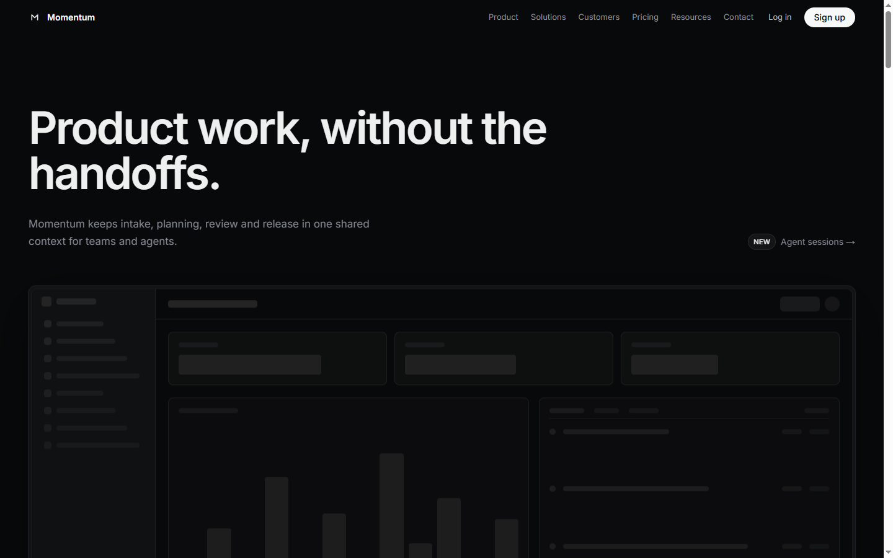

# Momentum

A product development system for teams and agents, built as a single-page marketing site with Next.js 14, TypeScript, Tailwind CSS and Framer Motion.



## What it is

A complete one-page product site: hero, customer strip, product principles, four feature sections with interactive mocks, changelog, testimonials and a closing call to action.

It is a front-end demo, not a SaaS product. There is no authentication, database, billing or live agent backend; the product surfaces are rendered as local React mockups and the calls to action are anchors.

## Why this over a product-site template

- **One design system.** Colour tokens, radii, spacing and type live in `src/lib/tokens.ts`, `src/app/globals.css` and `tailwind.config.ts`.
- **Content separated from presentation.** Navigation, hero, feature sections and footer copy live in `src/lib/content.ts` and `src/lib/body-content.ts`.
- **Interactive mocks, not screenshots.** The hero dashboard, intake board, planning view, agent cards and build review are React components with the same layout primitives.
- **Motion with intent.** Framer Motion handles section reveals and the marquee.
- **Self-hosted media.** Every image is stored under `public/`; the page makes no remote image, font or CDN requests at runtime.
- **Small dependency surface.** Next.js, React, Tailwind CSS, Framer Motion, Lucide and a few utility packages.

## Quick start

Requires Node.js 20 or newer and npm.

```bash
npm install
npm run dev
```

Open <http://localhost:3002>.

| Command | What it does |
| --- | --- |
| `npm run dev` | Starts the development server on port 3002. |
| `npm run build` | Creates the production build. |
| `npm run start` | Serves the production build on port 3002. |
| `npm run lint` | Runs ESLint. |
| `npm run typecheck` | Runs `tsc --noEmit`. |

## How the page is composed

`src/app/page.tsx` assembles five parts: `Navbar`, `Hero`, `StackSection`, `ProductBody` and `Footer`.

- `Navbar` reads `navLinks` and the brand mark.
- `Hero` renders the headline, subheadline and `HeroDashboardSkeleton`.
- `StackSection` renders the customer strip and caption.
- `ProductBody` renders the intro, four `FeatureSection` blocks, the changelog, testimonials and the closing section.
- `Footer` renders the link columns and legal row.

## Content and design tokens

- `src/lib/content.ts` owns navigation, hero, feature copy, changelog, testimonials, footer and the hero issue fixture.
- `src/lib/body-content.ts` owns the copy rendered by `ProductBody`.
- `src/lib/assets.ts` maps every image path used by the page.
- `src/lib/tokens.ts` owns layout, radii, colours and typography values.
- `src/styles/body.css` owns the product-section visual system.

## Project structure

```text
src/
  app/                 layout, page, global styles and app icon
  components/
    landing/           navbar, hero, stack section, footer
    landing/product-body/
                       intro, features, changelog, testimonials, closing
                       and local product mocks
    ui/                Container, Section, MotionSection, ProductScreenshot
  lib/                 content, assets, tokens and motion helpers
  styles/              product-body styles
public/
  brand/               brand mark and wordmark
  media/               local product imagery and customer assets
docs/
  screenshot.webp      README screenshot
  provenance.md        origin and asset notes
```

## Deployment

The project is built for Vercel with the Git integration. Every push to `main` produces a production deployment.

1. Import the repository in Vercel.
2. Keep the detected Next.js settings (`npm install`, `npm run build`).
3. Update the canonical origin in `src/app/layout.tsx` if the production domain changes.
4. Deploy and verify the home route, the app icon and the local media paths.

Live demo: <https://momentum-product.vercel.app>

## Status and scope

Verified locally with `npm run typecheck`, `npm run lint` and `npm run build`, plus a visual pass at 1440 px and 390 px.

Out of scope: authentication, payments, a CMS, live agent execution, analytics and additional routes. The product copy and customer names are fictional demonstration content.

## License

Proprietary, all rights reserved. See [LICENSE](LICENSE).
